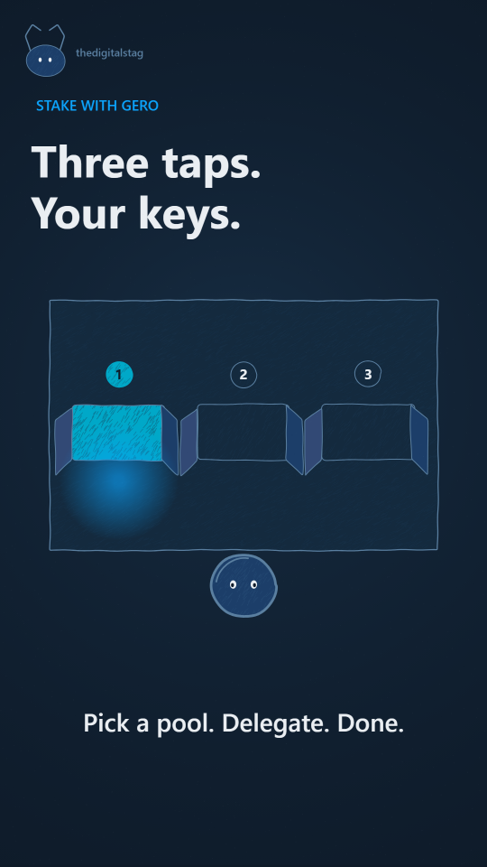

# thedigitalstag

A calm, considered, "verified" editorial look for thedigitalstag content. Dark navy stage; thin stag-blue lines that boil gently on 2s; a soft cyan accent reserved for Gero-wallet content; a small blue spot (the hero) present through every shot. No fake 3D, no fake UI — only what the medium can honestly draw.

**The one rule: everything in the frame should look like it belongs to thedigitalstag, and the stag-blue is the voice.** Stag blue carries structure (lines, the hero, cards, the watermark). The cyan accent carries "this piece is about Gero" — used only on the wallet UI, key numbers, and the word "Gero" on screen. White is type and the hero's eye.

This style was built from a Gero reference video (`refs/gero-earn-vertical-upbeat.mp4`) measured with `tools/measure/refs.mjs` and from thedigitalstag's brand spec (`brands/thedigitalstag/BRAND.md`). The motion and stage match the reference's calm rhythm; the line and palette belong to thedigitalstag.

## Palette

| token | hex | role |
|---|---|---|
| `bg` | `#0E1A28` | default stage. Reference measures `#010101`-`#0a0e11`; we use the stag dark mode for a touch more warmth |
| `surface` | `#142A3E` | cards, panels, raised surfaces |
| `surface_alt` | `#1B3650` | hover, active, secondary surface |
| `line` | `#5A7FA0` | primary line work, the stag-light on dark |
| `line_dark` | `#324975` | secondary line work, the stag mid |
| `ink` | `#1C3E69` | the stag primary, used for type on light, accents on dark |
| `paper` | `#EAEEF2` | off-white card surface (very sparing — type only) |
| `type` | `#EAEEF2` | body text on dark |
| `muted` | `#9FB0BF` | muted text on dark |
| `cyan_hi` | `#0CA3FB` | Gero accent gradient start, used for wallet UI + key numbers |
| `cyan_lo` | `#00EAEF` | Gero accent gradient end |
| `cyan_solid` | `#00A8C8` | single-tone cyan for icons and small text |

Gero cyan is locked to Gero-content only. On general thedigitalstag content (other wallets, creator stuff, behind-the-scenes), the cyan tokens are unused. This is a brand rule, not a visual preference — see `brands/thedigitalstag/BRAND.md` and `LEGAL.md`.

## The medium

- **`ink(points, { w, color, amt, key, frac })`**: a wobbly line in `line` or `muted`, reseeded every boil step. Width 2.5–4 for content, 1.5 for fine details, 4–6 for the hero's outline.
- **`paint(points, { fill, w, line, tex: [...] })`**: a filled shape with `line` outline. Texture is **shading**, not a fill — `pencil` (light, per-cell density) for subtle volume, `stipple` for sparse material, `hatch` for hard light.
- **`grain({ n, al })`** over every frame: a sparse, low-alpha grain (1600 dots, alpha ~0.08) so the dark never reads as a flat fill.
- **No fake 3D blocks.** The reference uses heavy isometric 3D renders; we don't. Where a "block" makes sense, draw it as a thin isometric line slab (constant hairline, white faces, one dark accent) — see the `isoSlab` helper.
- **The stage is dark.** Every frame clears to `bg` and the renderer draws the era through `STYLE.backdrop`. There is no white or paper sheet in the picture (the morph `STYLE.paper` is a near-black `#0E1A28`, so a morph in the dark doesn't blend from a light sheet).

## Motion habits

- **On 2s** (`ones: false`): `TT = B * 2 / FPS`; lines boil (re-wobble) every 2 frames so even held shots are alive. Camera, idle bob, grain and accent glow step on the same index.
- **Tempo is ~30% slower than the upbeat reference** to feel "verified", not "hype". The reference holds each step ~3s; we hold ~2s but on 2s steps, so motion still reads.
- **Springs** for anything with mass (`springMove`, `springTrack` in `kit/core.js`). `smooth` preset for the camera, `snappy` for the hero's bob, `heavy` for big type.
- **Easing** is ease-in-out by default; linear only for the grain pass and the camera.
- **Cuts on the 8th grid** (120 BPM at 24fps: 6 frames). Morphs only between eras; pieces under 30s budget ≤ 3 morphs.
- **The hero is always present**: a small stag-blue spot that bobs and blinks. It carries through every era so the eye has a constant.
- **Idle life is free**: the stag's head bobs on its own; the watermark stag's ears wiggle (`(B % 41) < 2`); key numbers pulse on a 4-beat cycle.

## Composition

- **Hero placement**: bottom-third, slightly off-centre (`x ≈ 540`, `y ≈ 1280` at 1080x1920). Never overlaps the caption strip.
- **Corner watermark**: top-left, ~80px wide, ~50% opacity. A small stag-circle (the brand) — does not move, does not pulse, does not compete with content. Drawn in `DEFER` so it sits over the camera transform.
- **Title block**: top, set in Inter 700, `type` color, 96–128px display / 64–80px H1. A small `cyan_hi` "section" tag above (e.g. "SWAP IN YOUR WALLET") in Inter 600 28px tracked +0.1em.
- **Body / caption**: middle, monospace for facts and numbers (`monoText` / `monoW` from `kit/core.js`), hand for quotes (`handwrite`).
- **End card**: full lockup. Stag mark, "thedigitalstag" wordmark, "Independent Gero content creator" disclaimer, and the cyan "gerowallet.io" pill on Gero content.
- **Safe area**: `x 60–940`, `y 250–1500` at 1080x1920. The platform UI covers the rest. Anything that matters ≥ 100px; captions ≥ 50px.

## Frame checklist (on top of `grammar/FRAME.md`)

1. **Background is dark navy**, never pure black. Grain pass present, no flat fills.
2. **Every filled shape has a texture** (pencil/stipple/hatch) shaped by light — no flat fills except the bg, surface, and the hero's spot.
3. **Lines boil** — never a perfectly still stroke in a held frame.
4. **The hero spot is present** in every era, at the same scale, with the same eyes. It bobs on 2s and blinks every ~2s.
5. **The corner watermark stag** is in the top-left, small, calm, present throughout.
6. **Cyan accent only on Gero content** — wallet UI, key numbers, the "Gero" word on screen, the gerowallet.io pill on the end card. On non-Gero content, cyan is absent.
7. **Type is set in Inter** for display + body, monospace for facts. No fake-handwritten type for headlines.
8. **Cards have a thin stag-light outline** (`#5A7FA0`, 2–3px). No drop shadows. No glow on chrome.
9. **The "end is the start, changed"** — the last frame echoes the first but the hero has moved / the numbers are filled / a check has appeared.
10. **The phone scale test**: every label readable on a 360px-wide contact sheet. Text check matters more than the eye.

## Kit API (`styles/thedigitalstag/kit.js`, on top of `kit/core.js`)

- **Stage:** `dsBackdrop(c)` fills the frame with the bg, grain, and a faint vignette. Always the first call in a scene.
- **Surfaces:** `dsCard(x, y, w, h, key, { fill, line, wline })` paints a card; `dsPanel(...)` is a taller variant for side panels; `dsSlab(...)` is a thin isometric line slab (the visual proxy for a "block" in the reference).
- **Lines:** all of `kit/core.js` is available: `ink`, `paint`, `hatch`, `pencil`, `stipple`, `wobble`, `grain`, `construct`, `ruler`, `monoText`, `monoW`, `handwrite`, `drawPencil`. New helpers: `dsAccent(...)` (cyan underline / glow), `dsPill(str, x, y, ...)` (a small cyan pill, used for the gerowallet.io CTA).
- **Hero:** `dsHero(x, y, r, { key, mood, blink })` paints the stag-blue spot, bobs on 2s, blinks every ~2s. Sets `SPARK_AT` for the anchor check.
- **Watermark:** `dsWatermark()` — top-left stag-circle at 50% opacity. Pushed through `DEFER` so it sits over the camera.
- **Captions:** `dsTag(str)` (a small Inter 600 tag, top-left, `cyan_hi`) and `dsCaption(str)` (a centered Inter 500 caption, off-white). Both go through `DEFER` to draw after the camera at screen size.
- **STYLE hooks:** `backdrop` calls `dsBackdrop`, `window` draws the era through a thin stag-light outline (no iris, no irisHole — the dark stage gets a clean rectangular window), `blob` paints the morphing shape as a stag-light slab, `hero` calls `dsHero`, `post` runs the grain pass.
- **Cost:** ~30–60 ms per frame at 1080x1920 (no per-pixel print pass; canvas operations only).

## Do / don't

**Do**
- Keep cyan reserved. If a piece has no Gero reference, don't reach for the cyan.
- Use monospace for any number on screen.
- Add a "what changed" detail in the final frame.
- Key boil variation on `B` (line wobble, hero bob, grain).
- Crop a wide source to 9:16 around one subject.

**Don't**
- Don't use the Gero antler mark. Don't use the "GeroWallet" wordmark. Don't draw the cyan gradient as the page bg. (See `LEGAL.md`.)
- Don't make the hero huge. It's a small spot — calm, present, not loud.
- Don't fade a prop with `globalAlpha`; `paint()`/`hatch()` reset it. Skip the prop instead.
- Don't trust the eye for text overlap. Run `tools/textcheck.mjs` and trust its report.
- Don't reuse the crosshatch kit's `darkWorld` directly here — the look is calmer and the grain is sparser.

## Proven on

This style's `demo/` is the first piece it has carried: a 6-second 9:16 morph chain that proves the kit renders, morphs cleanly between two dark eras, holds the hero through the cut, and stays deterministic. After the first real piece is built and approved, add it to this list.
